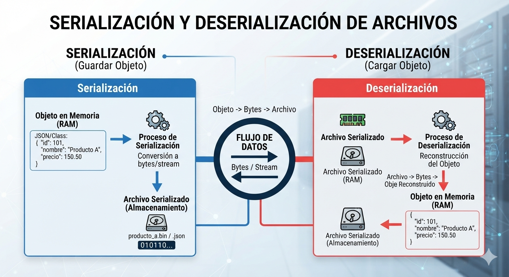
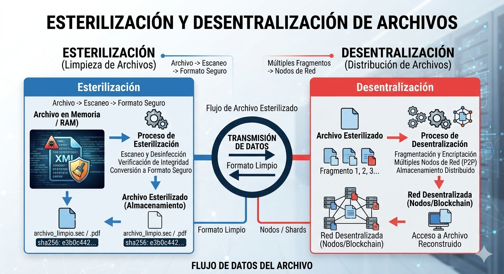

# Serialización y Deserialización con Ejemplos

Guía didáctica del proceso de serialización (objeto → bytes) y deserialización (bytes → objeto), con ejemplos paso a paso en bloques. Complementa la nota teórica [Archivos, Streams y Serialización](archivos-streams-serializacion.md).

## 1. El concepto en una frase

- **Serializar** (guardar objeto): convertir un objeto vivo en memoria (RAM) a una secuencia de bytes portable.
- **Deserializar** (cargar objeto): reconstruir el objeto en memoria a partir de esa secuencia de bytes.

```
MEMORIA (objeto) ──serializar──▶ BYTES ──▶ archivo / red / BD / memoria
MEMORIA (objeto) ◀─deserializar── BYTES ◀── archivo / red / BD / memoria
```

## 2. Panorama general (figura)



> Fuente: [Drive 2](https://drive.google.com/file/d/1MjIc1it76q1fGjf9aKKv40ip5UsxrAaD/view?usp=sharing)

La figura muestra el ciclo completo con un `Producto` de ejemplo. Léela de izquierda a derecha:

- **Lado azul (Serialización / "Guardar objeto")**:
  1. **Objeto en memoria (RAM)**: una clase/JSON `{"id": 101, "nombre": "Producto A", "precio": 150.50}`.
  2. **Proceso de Serialización**: conversión del objeto a bytes/stream.
  3. **Archivo serializado (almacenamiento)**: `producto_a.bin` o `.json` — puros bytes `010110...`.
- **Centro**: el **flujo de datos** (bytes/stream) que une ambos mundos. Ese flujo puede ir también a red, base de datos o memoria compartida, no solo a disco.
- **Lado rojo (Deserialización / "Cargar objeto")**:
  1. **Archivo serializado** leído desde almacenamiento.
  2. **Proceso de Deserialización**: archivo → bytes → reconstrucción del objeto.
  3. **Objeto en memoria (RAM)** nuevamente disponible, con el mismo estado `{"id": 101, "nombre": "Producto A", "precio": 150.50}`.

## 3. ¿Para qué sirve?

| Caso de uso | Ejemplo |
|-------------|---------|
| Persistencia | Guardar un objeto en archivo o base de datos |
| Comunicación | Enviar objetos por red (APIs REST, gRPC, Kafka, RabbitMQ) |
| Caché | Guardar objetos en Redis / Memcached |
| Sesiones / clonado | Mantener estado entre requests, deep copy de objetos |

## 4. Proceso de serialización desglosado en bloques

Recorremos el **lado azul de la figura** con el mismo ejemplo del `Producto`, ahora en código.

### Bloque 1 — Objeto en memoria ("Objeto en Memoria / RAM" de la figura)

```python
class Producto:
    def __init__(self, id, nombre, precio):
        self.id = id           # int
        self.nombre = nombre   # str
        self.precio = precio   # float

p = Producto(101, "Producto A", 150.50)
```

El objeto vive en el heap: referencias, tipos, valores. Nada de esto es portable aún — si el proceso termina, el objeto desaparece.

### Bloque 2 — Grafo → estructura intermedia

El serializador recorre el grafo del objeto (atributos, objetos anidados, colecciones) y lo convierte a un modelo de datos exportable — el JSON que aparece en la figura:

```
Producto ──▶ { "id": 101, "nombre": "Producto A", "precio": 150.50 }
```

Aquí se deciden cosas como: campos a incluir/excluir, nombres de claves, manejo de referencias cíclicas y polimorfismo.

### Bloque 3 — Estructura → bytes (encoding)

La estructura se codifica al formato elegido. Son los `010110...` de la figura:

```
JSON (texto UTF-8):  b'{"id": 101, "nombre": "Producto A", "precio": 150.5}'
Binario (protobuf):  bytes compactos con field numbers, no legibles
```

### Bloque 4 — Escritura al destino ("Archivo Serializado" de la figura)

Los bytes se escriben a través de un stream hacia el destino:

```python
import json

with open("producto_a.json", "w", encoding="utf-8") as f:
    json.dump(p.__dict__, f)   # Bloque 2 + 3 + 4 en una línea
```

Destinos posibles (los que muestra el diagrama de Scientech Easy del chat): **archivo**, **base de datos**, **memoria**; y por extensión: socket de red o cola de mensajes.

## 5. Proceso de deserialización desglosado en bloques

Ahora el **lado rojo de la figura**: el camino inverso, con validación de por medio.

### Bloque 1 — Lectura de bytes

```python
with open("producto_a.json", "r", encoding="utf-8") as f:
    contenido = f.read()
# '{"id": 101, "nombre": "Producto A", "precio": 150.5}'
```

### Bloque 2 — Bytes → estructura (parsing)

```python
data = json.loads(contenido)
# dict: {'id': 101, 'nombre': 'Producto A', 'precio': 150.5}
```

El parser convierte el flujo de bytes en un modelo de datos genérico (dict, árbol XML, mensaje protobuf). En la figura: "Archivo → Bytes".

### Bloque 3 — Validación y mapeo ("Reconstrucción del Objeto")

Punto crítico: verificar que la estructura coincide con lo que la clase espera (campos, tipos, valores). Con librerías como **Pydantic** esto es automático:

```python
from pydantic import BaseModel

class Producto(BaseModel):
    id: int
    nombre: str
    precio: float

p2 = Producto(**data)   # valida tipos; lanza error si algo no cuadra
```

### Bloque 4 — Objeto reconstruido en memoria

`p2` es la caja roja final de la figura ("Objeto en Memoria / RAM"): un objeto **nuevo**, equivalente al original — mismo estado, distinta identidad (otra dirección de memoria). El ciclo se completa.

## 6. Ejemplo completo comparando formatos

```python
import json, pickle
from dataclasses import dataclass, asdict

@dataclass
class Producto:
    id: int
    nombre: str
    precio: float

p = Producto(101, "Producto A", 150.50)

# --- JSON (texto, interoperable) ---
json_bytes = json.dumps(asdict(p)).encode("utf-8")
p_json = Producto(**json.loads(json_bytes))

# --- Pickle (binario, solo Python, NO seguro con datos externos) ---
pickle_bytes = pickle.dumps(p)
p_pickle = pickle.loads(pickle_bytes)
```

| Formato | Ejemplos | Ventajas | Desventajas |
|---------|----------|----------|-------------|
| Texto | JSON, XML, YAML | Legible, interoperable, lenguaje-agnóstico | Más grande y lento |
| Binario con esquema | Protobuf, Avro, Thrift | Compacto, rápido, evolución de esquema | No legible, requiere definir esquema |
| Binario nativo | pickle, Java `Serializable` | Cero configuración | Solo ese lenguaje; **riesgo de seguridad** |

## 7. Ejemplo en Java (serialización nativa)

```java
import java.io.*;

public class Producto implements Serializable {
    private static final long serialVersionUID = 1L;  // control de versionado
    int id;
    String nombre;
    double precio;
}

// Serializar
try (ObjectOutputStream out = new ObjectOutputStream(new FileOutputStream("producto.ser"))) {
    out.writeObject(new Producto());
}

// Deserializar
try (ObjectInputStream in = new ObjectInputStream(new FileInputStream("producto.ser"))) {
    Producto p = (Producto) in.readObject();
}
```

## 8. Riesgos y buenas prácticas

1. **Deserialización insegura**: con `pickle`, Java `ObjectInputStream` o .NET `BinaryFormatter`, datos de origen no confiable pueden **ejecutar código arbitrario** (OWASP A8). Preferir JSON/protobuf o listas blancas de tipos.
2. **Versionado**: si la clase cambia, datos antiguos pueden fallar. Usar campos opcionales, valores por defecto y `serialVersionUID` (Java) / esquemas evolutivos (protobuf: nunca reusar field numbers).
3. **Ciclos y referencias**: objetos que se referencian entre sí requieren formatos que preserven identidad (`$id`/`$ref`) o romper los ciclos antes.
4. **Límites**: definir `max_message_size` y profundidad máxima para evitar DoS por payloads gigantes.

## 9. Más allá: esterilización y desentralización de archivos



> Fuente: [Drive 1](https://drive.google.com/file/d/1BLLN-hANiI8ToEHeGmTtE55nT3k2preG/view?usp=sharing)

Esta segunda figura lleva el flujo anterior un paso más allá y conecta directamente con los riesgos de la sección 8:

- **Esterilización (lado azul)**: antes de almacenar o transmitir un archivo, este pasa por un proceso de *limpieza*: **Archivo → Escaneo → Formato seguro**. Se desinfecta el contenido, se verifica integridad y se convierte a un formato seguro, produciendo un archivo esterilizado (`archivo_limpio.sec` / `.pdf`) con su huella **SHA-256** (`e3b0c442...`) para verificar integridad después. Es la respuesta práctica al riesgo de deserialización insegura: *no confíes en el byte stream entrante*.
- **Transmisión**: el archivo limpio viaja como flujo de datos esterilizado, en formato limpio.
- **Desentralización (lado rojo)**: en lugar de guardar el archivo en un solo lugar, se **fragmenta** (Fragmento 1, 2, 3...), se **encripta** y se distribuye en **múltiples nodos de red P2P** o una red tipo **blockchain**. Para recuperarlo, se ensamblan los fragmentos desde los nodos y el usuario accede al archivo reconstruido.

Relación con serialización: la esterilización se aplica *sobre* el byte stream serializado (escanear lo que vas a guardar/cargar), y la desentralización es un **destino avanzado** para ese byte stream (en lugar de un archivo local o una BD centralizada).

## 10. Conversación original (contexto)

> **Usuario**: *(imagen "How to Serialize (Store) and De-serialize (Re-store back) Objects?" de Scientech Easy: Object → Byte Stream → File/Database/Memory → Byte Stream → Object)* — hablemos de serialización y deserialización.
>
> **Asistente**: La serialización convierte un objeto en memoria a un formato almacenable/transmisible (byte stream o texto como JSON/XML); la deserialización hace lo inverso. Sirve para persistencia (archivo/BD), comunicación en red (APIs, colas), caché y sesiones. Hay formatos de texto (JSON, XML: legibles e interoperables), binarios con esquema (Protobuf, Avro, MessagePack: compactos y rápidos) y nativos (pickle, Java Serializable: fáciles pero con riesgos de seguridad). Cuidados clave: deserialización insegura (ejecución de código, OWASP A8), versionado de esquemas (`serialVersionUID`) y manejo de referencias/ciclos.
>
> **Usuario**: comparte las 2 figuras de Drive e incluye ejemplos desglosados por bloques → secciones 4 y 5 de esta nota.

## Ver también

* [Archivos, Streams y Serialización](archivos-streams-serializacion.md) — teoría de los tres pilares
* [Streams: Qué son y Ventajas](streams-ventajas.md)
* [Archivos, Permisos y Metadatos](archivos-permisos-metadatos.md)
* [Recuperación de Estado sin Base de Datos](recuperacion-estado-sin-bd.md)
